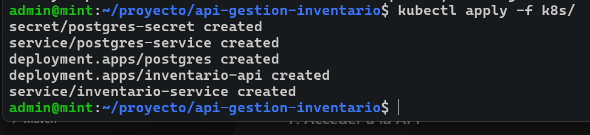
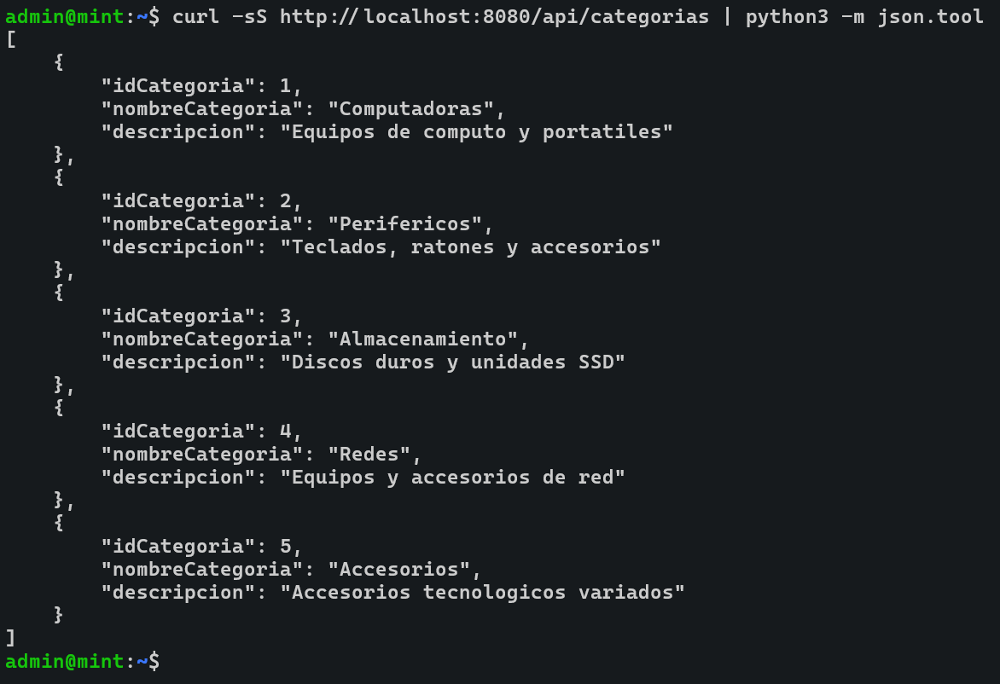
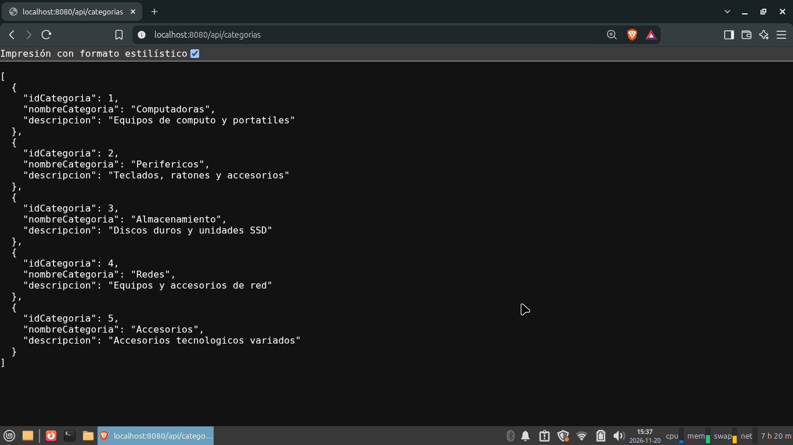
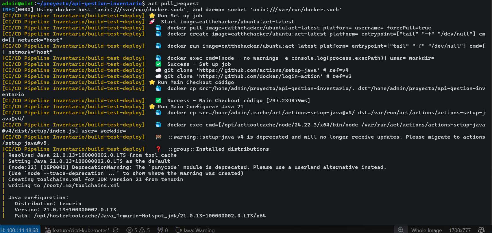
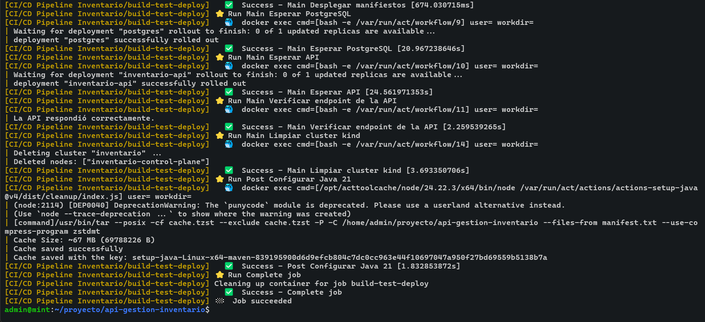

# Despliegue con Kubernetes y ejecución del pipeline con act

>[!NOTE]
> En este documento se describen los requisitos para probar el despliegue local en Kubernetes y ejecutar el pipeline con `act`.

## Requisitos
| Herramienta | Uso |
|---|---|
| Docker | Construir la imagen de la API |
| `kind` | Crear un cluster Kubernetes local dentro de contenedores Docker |
| `kubectl` | Aplicar los manifiestos de `k8s/` y consultar el estado de los recursos del clúster |
| `act` | Ejecutar localmente el workflow de GitHub Actions para probar el pipeline. Es opcional para el despliegue manual |

## Despliegue manual en Kubernetes
```bash
cd api-gestion-inventario
```

### 1. Crear el clúster local
```bash
kind create cluster --name inventario
```

### 2. Construir la imagen de la API
```bash
docker build -t api-gestion-inventario:latest .
```

### 3. Cargar la imagen en el clúster
```bash
kind load docker-image api-gestion-inventario:latest --name inventario
```

### 4. Aplicar los manifiestos
```bash
kubectl apply -f k8s/
```

### 5. Esperar a que PostgreSQL y la API esten listos
```bash
kubectl rollout status deployment/postgres --timeout=120s
kubectl rollout status deployment/inventario-api --timeout=180s
```

### 6. Comprobar los pods y servicios
```bash
kubectl get pods
kubectl get services
```

### 7. Acceder a la API
En una terminal, inicia el reenvío del puerto:

```bash
kubectl port-forward service/inventario-service 8080:8080
```

Mientras el comando siga ejecutandose, consulta el endpoint desde otra terminal.

Linux:

```bash
curl http://localhost:8080/api/categorias
```

Windows PowerShell:

```powershell
curl.exe http://localhost:8080/api/categorias
```

Para detener el reenvío, presiona `Ctrl+C`.

>[!NOTE]
> Tambien se puede probar desde un navegador a traves de la URL

### 8. Eliminar el cluster
Al terminar la prueba, elimina el cluster y sus contenedores:

```bash
kind delete cluster --name inventario
```

Opcionalmente, elimina la imagen local para liberar espacio en disco:

```bash
docker rmi api-gestion-inventario:latest
```

## Ejecutar el pipeline localmente con act
>[!WARNING]
> Si ya esta creado el cluster, debe eliminarse. De lo contrario no se ejecutará el pipeline

Desde la raíz del proyecto, con Docker en ejecucion:

```bash
act pull_request
```

La primera vez, selecciona la imagen **Medium** cuando `act` lo solicite. El workflow ejecuta las pruebas, construye la imagen, crea un cluster temporal de `kind`, aplica los manifiestos y comprueba la API. Al finalizar, elimina el cluster.

## Evidencias de despliegue
### Despliegue en Kubernetes
- **Aplicacion de los manifiestos**


- **Prueba con curl**


- **Prueba desde el navegador**


### Ejecucion del pipeline en local con `act`

